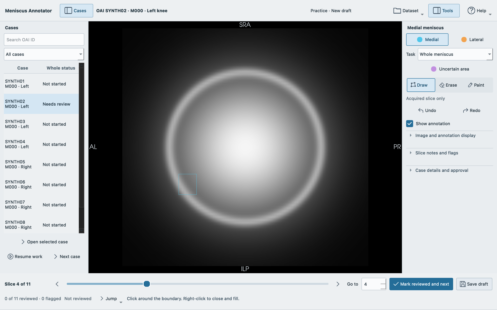
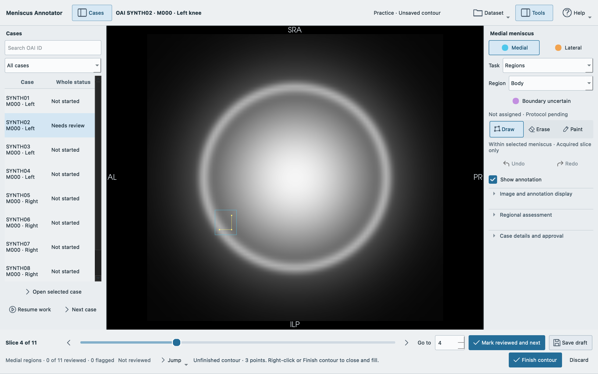
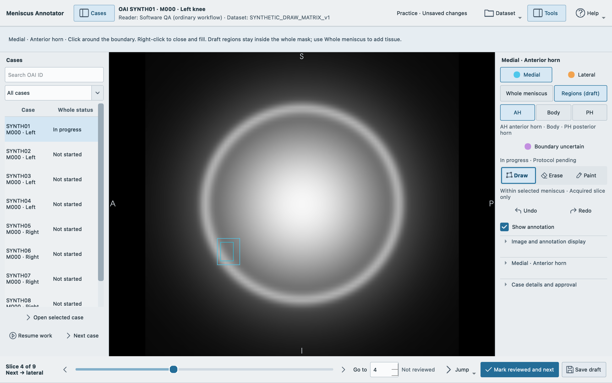

# Meniscus annotation guide

This is a repaired review candidate for supervised software practice. Native Windows image editing, display scaling and strict offline acceptance remain pending.

This guide covers Meniscus Annotator 0.2.0 for the reader named in an assigned
annotation package. Use the supplied practice package while testing. Research
approval requires a released drawing protocol. This application and its 3D Slicer
runtime are for research annotation, not clinical diagnosis or treatment. Slicer’s
first-use research notice is consistent with that restriction.

## Install and update

Run the supplied **0.2.0 Windows x64 installer** and open Meniscus Annotator from
the Start menu. It includes the pinned runtime; no separate Python or Slicer
installation is required. The installer is unsigned, so Windows may show
**Unknown publisher** or a SmartScreen warning. Confirm the authorized download
source and the coordinator's SHA256 checksum; ask institutional IT to verify or
approve installation if needed. Do not disable Windows or institutional protections.

To replace 0.1.0, save your work and close the old application normally. Preserve
the separate work folder, original dataset and return ZIPs. Uninstall the earlier
application through Windows Settings, then install 0.2.0. Open the original dataset
and confirm the same reader. If needed, choose **Open existing work** and select
the work folder containing `dataset.json` and `cases`, not the input dataset.
Do not rename or manually merge checkpoint files. Existing saved versions stay
intact. Keep one application version throughout an annotation batch.

## Open and resume

After receiving the software and **complete assigned case folder**, extract any
ZIP files and keep a complete local copy. Install the supplied application, then choose **Open dataset** and select its top-level folder. The
coordinator supplies only assigned pilot cases, not the full selection containing
reserved test cases. Keep
`README.txt`, `case_index.csv` and all `Cases` subfolders together. The application
checks identities, hashes and geometry before offering editing.

A prepared correction package includes an explicit `correction_job.json`. Its
verified starting masks load as unreviewed predictions to correct, not completed
annotations. Missing or unresolved masks are blocked instead of replaced with
blank labels. MRI-only packages without a job require an explicit confirmation
before drawing from blank; the default is No. If you expected predictions,
cancel and obtain the correction package. In **Confirm reader identity**, enter
your **Reader name or study ID**, check **I confirm this is my reader identity**
and choose **Continue**. Use the same spelling each time. On a shared account,
check the displayed **Last used** name rather than accepting another reader’s
identity. An assignment that names a reader must be confirmed only by that reader.

The header shows the case, visit, knee side and save state. The selected compartment
appears in the annotation panel. **Case details and approval** shows the reader,
dataset information and correction or blank mode. A slice can have no starting
mask even when a prediction is loaded for the case. The neutral message **No
starting mask on this slice** does not mean the meniscus is absent or that one
must be drawn. Inspect the complete acquired stack under the supplied protocol.

For correction: inspect the MRI with the overlay both hidden and visible, check
the medial/lateral assignments, erase extra predicted tissue and add missing
tissue under the supplied drawing protocol. **Erase affects the active label
only**. Inspect every acquired slice, including slices outside the starting
prediction. The predictions are suggestions, not expert-approved anatomy.

Rows marked **Blocked** cannot be edited and Next case skips them. **Saved work
needs attention** means an existing checkpoint is incompatible or unavailable;
preserve the work folder and contact the coordinator instead of starting over.

The first connection proposes a local application-data work folder, separate
from Documents folders that may be redirected to OneDrive. Each reader receives a separate subfolder
so different readers do not share checkpoints. You can choose another
**local** work folder then. It must be separate from the source dataset and
outside Dropbox/OneDrive. The application checks common synced paths, but cannot
identify every institutional synchronization policy. Confirm a persistent local
location with your coordinator. **Dataset → Reader and dataset** shows the reader,
dataset and exact work path; **Dataset → Show saved work** opens it. Source images,
starting masks and metadata remain unchanged.

The normal Windows root is `%LOCALAPPDATA%\MeniscusAnnotator\work\`; macOS uses
`~/Library/Application Support/MeniscusAnnotator/work/`. Dataset and reader
subfolders are managed automatically. Previously connected valid work locations
remain in use; the menu shows the actual path for your assignment.

Double-click a case or select it and choose **Open selected case**. Search by
OAI ID, visit or side; use the progress filter as needed. **Resume work** opens
the previous dataset/case. The last acquired slice is remembered. If you move
the downloaded dataset, choose **Open dataset** at its new location. The original
identity and hashes must match the existing work folder.

Keep the assigned job and protocol unchanged once work starts. They are bound
to saved checkpoints. Do not use **Help → Annotation setup** to substitute a
different job during a pilot; the coordinator must arrange a separate work
folder or a validated migration. A draft pilot produces practice results, not
approved training annotations.

## Draw and inspect

The header shows OAI ID, visit and knee side. The prominent bottom readout and slider count
**1 to N**, including every acquired slice. The primary view follows the acquired
planes even on a tilted scan. Letters at its edges describe actual physical
orientation; combinations such as `SLP` indicate an oblique direction. Secondary
reformats are for orientation and cannot be edited.

**Draw is selected when a case opens.** Choose the named label, then **Draw**,
**Erase** or **Paint**. The selected compartment and tool are identified by text
and selected controls. Brush diameter appears only for Paint and Erase. Medial is cyan
(label 1); lateral is orange (label 2). Painting one replaces overlapping voxels
of the other. **Uncertain area** is purple and may overlap either meniscus; it
is saved separately and never converted silently to background or a third
training class. Erase uncertainty using that label’s Erase tool. Drawing one
anatomical label over the other can transfer tissue between compartments; a
notice reports the transfer and offers **Undo**. Inspect that correction deliberately.

The compact instruction beneath the slice slider follows the active tool.
For **Draw**: **Click around the boundary. Right-click to close and fill.**
Place at least three boundary points. The visible line and points in the active target color are an
unfinished contour, distinct from the committed mask. Right-click without
dragging, or choose **Finish contour**, to add the filled region to the selected
label on this acquired slice. Use Erase to remove excess pixels; Paint adds small
corrections by left-dragging. Undo/Redo restores committed edits across labels.

While a contour is unfinished, the status says **Unsaved contour**. Slice,
compartment, tool and case changes, saving, review and normal closing remain
blocked until you finish or discard it. **Discard** asks for confirmation;
**Keep drawing** is the default. **X** removes the last contour point. Escape
opens the discard choice while drawing; without a contour it selects Navigate.
Unfinished contours are not saved checkpoints and are not restored after a crash.
On normal window close, choose **Finish contour**, **Discard contour** or
**Keep drawing** in the prompt. Keep drawing is the default. Finish requires at
least three valid points. No unfinished contour is silently applied to another slice.

On reopening, recover work from saved checkpoints; the previous session's
in-memory undo history is not restored.

Use **Show annotation** beside the editing tools to inspect the underlying MRI.
Outlines default to 2 px. **Image and annotation display** provides **Outline width**,
adjustable transparent fill, window/level, Reset view and orientation reformats. These are
display settings; they do not move, smooth or change the saved boundary.
Use the slice slider, Previous/Next, mouse wheel or Go to for acquired-slice
navigation. **Ctrl+wheel zooms; middle-button dragging pans.** Draw reserves the
right button for finishing: a right-drag keeps the unfinished contour and does
not zoom or apply it. To adjust brightness and contrast, open **Image and annotation display**,
choose **Window/level**, then **left-drag on the image**. Choose Paint, Draw or
Erase to return to annotation. Zoom and window/level remain in effect while
stepping through the case. **Cases** and **Tools** in the
header collapse and reopen the side panels. Their visibility and widths are
remembered. Close Cases while drawing to give the MRI more space. Brush diameter
is also remembered.

New correction cases open on the first slice containing a starting mask when
available. Previously saved cases restore their last slice. Every slice remains
accessible. The acquired view presents anterior toward the left using verified
physical geometry; oblique edge letters may contain more than one direction.
**Next: toward medial/lateral** describes increasing slice number. When the scan’s
direction is mixed, the app says **Next: oblique direction** instead. These are
navigation cues, not compartment assignments. A **Check medial/lateral labels**
note is an advisory to inspect the MRI; it never swaps labels or validates anatomy.

## Whole menisci and regions

Whole-meniscus labels remain the complete medial meniscus (1) and lateral
meniscus (2), including the body. Knee side, mirroring and slice order never swap
these identities. Correct the whole masks first under the supplied protocol.

In the annotation panel, choose **Whole meniscus** for the complete mask or
**Regions (draft)** for regional assignments. **Body** is one region inside the
whole meniscus, not an alternative name for the complete meniscus.

**Regions (draft)** assigns **AH** (anterior horn), **Body** or **PH** (posterior horn) within
the selected Medial or Lateral mask. The same Draw, Erase and Paint tools apply
only inside that parent meniscus. To add missing tissue, return to **Whole
meniscus**. Erasing a regional assignment makes that tissue unassigned; it does
not erase the whole mask. Turn off **Show regions** to inspect the MRI.

Existing whole-only masks start **Not assigned**. Regions are never initialized
from image halves, bounding-box thirds, screen position or slice number. Use
the named **assessment** panel to record Present, Absent or Uncertain for the selected
region and add a note; leave **Unassessed** until it has been considered. An
absent region need not contain voxels, and a region with assigned voxels cannot
be recorded as absent. **Boundary
uncertain** records separate regional uncertainty; it never creates another
training class. **Flag regional review** records attention. In
Regions, **Mark reviewed and next** reviews the selected compartment on the
acquired slice. Repeat regional review for both compartments; this is tracked
separately from whole-meniscus review. The assessment heading names its
compartment and region. Its note applies to that selected region across the case.
Changing an assessment does not erase slice-review marks; edits to assigned
tissue still require re-review.

**The regional anatomical protocol is pending.** Study experts must
supply the boundaries and handling of roots, tears, maceration, surgery and
uncertain tissue. The controls support draft software practice; they do not
establish anatomical rules or validated horn separation. Regional research
approval is unavailable, and all regional training-validity voxels are zero in
this version, even if the whole mask has been approved.

If a whole mask changes, assignments outside its updated parent are removed,
new tissue becomes unassigned and affected regional review needs rechecking.
Earlier saved versions remain intact. Save draft preserves both representations;
saving never approves either task. See [the regional file contract](REGIONAL_CONTRACT.md)
for the fixed six-region dictionary and explicit unassigned values.

## Review, save and approve

Scrolling does **not** mark a slice reviewed. After inspecting each slice,
including an empty one, use **Mark reviewed and next**. **Jump → Next unreviewed slice** and
**Next flagged slice** help finish review. A flag records attention separately from
review. **Reviewed** or **Not reviewed** appears in the bottom strip. Any
anatomical or uncertainty edit marks affected slices for rechecking. Expand
**Case notes and slice flag** for a case-level note and **Flag this slice** for
the current acquired slice. The case note is shared across the case; it is not a
separate note for each slice. Regional notes and flags are separate in the
target-named assessment panel. Shortcuts do not act while typing text.

Use **Save draft** whenever needed. The application also saves every minute
when committed work changes, before switching cases and on normal window close.
Slice review is recorded separately. Autosave waits while a contour is unfinished.
The save indicator only reports success after saved files
have been reopened and checked. A failure keeps previous checkpoints intact;
check free space and permissions and retry before leaving the case. Do not run
two instances on the same case. If the application crashes, reopen the dataset
and case to restore the newest intact saved checkpoint. Unsaved changes since
the last checkpoint may be lost.

After all whole-mask slices are reviewed, the next-step instruction offers
**Go to approval**. It opens and scrolls to the compartment confirmations. Saving
and marking a slice reviewed remain separate from approval. Re-marking an already
reviewed slice without changing tissue does not remove its existing approval.

For whole-meniscus approval, choose **Whole meniscus**, review all slices,
resolve whole-mask uncertainty and flags, and expand
**Case details and approval**. Confirm both compartment checkboxes there, then choose
**Approve practice case** for a draft protocol, or **Approve case** under a released
protocol. Approval requires your deliberate
confirmation. In the ordinary assigned-annotation workflow, the named reader is recorded as
both annotator and approver; this is not an independent second-reader review. Technical checks do not establish anatomical
correctness. Without a released protocol, approval is clearly marked **practice**.

The separate **SOFTWARE PRACTICE** workspace records explicit practice/test actors,
rather than a doctor. Its review and approval actions exercise software only. Every voxel in
its exported validity image remains zero, including after approval; neither
labels nor background are accepted research training annotations.

Editing an approved annotation creates a new draft. The previous approved
checkpoint remains unchanged. Re-review changed slices and approve a new version
when ready.

## Export and hand off

Choose **Dataset → Export results**. Review the table's case, result, checkpoint
version and action/reason before confirming. Use **Selected cases only** for the
rows selected in Cases, or return all eligible cases with exclusions listed.
Cases with unresolved uncertainty, flags or incomplete review cannot be approved;
the export summary identifies excluded cases and what to complete.

When newer unapproved work exists, Export requires a deliberate decision. Approve
the newest work, choose **Explicitly use the earlier approved versions listed
below**, or choose **Exclude cases with newer unapproved work**. Earlier-version
export omits those newer edits. The application does not silently substitute an
older approval. Check the included and excluded counts before sending results.

For a draft anatomical protocol, **Practice results only — draft anatomical
protocol** is selected automatically and cannot be turned off. Explicit software
practice uses **Software-practice results only — not research annotations**.
Practice ZIPs are clearly named and marked as ineligible for research/training;
draft completion never creates research approval.

Choose **Export**, then a destination. The application creates a versioned ZIP in
the destination's `Meniscus_annotation_results` subfolder and checks it before
reporting success. **Show exported file** opens that folder. No MRI image is
duplicated. Return the ZIP through the coordinator's authorized route and keep
the local work folder until receipt is confirmed.

The export contains editable Slicer segmentations, full-grid medial/lateral
labels, separate uncertainty/validity images, slice-review tables, hashes and
annotation/approval metadata. The confirmed checkpoint versions and exclusions
are recorded in `results.json`. Training code must respect the recorded research
eligibility, validity and uncertainty; review coverage alone is not research approval.
When regional work is included, its labels, separate uncertainty, review records
and protocol provenance remain draft regional files. Whole-meniscus approval
does not approve them. Their regional validity image is zero everywhere while
the expert protocol is pending.
SOFTWARE PRACTICE exports use the `SOFTWARE_PRACTICE_ONLY-` prefix, remain separate, have all-zero validity images and
must not be used as accepted research annotations.

**Help → Annotation setup** is for a coordinator-supplied, dataset-bound JSON.
It records the protocol and explicitly permitted correction mask. An MRI-only
package without a job asks whether blank annotation is intentional. If you expect
automated masks to correct, choose No and ask for the assigned correction package. Do not edit job
configuration to promote a draft protocol yourself. Changing initialization or
protocol for existing work requires a separately coordinated work folder/batch.

## MRI view shortcuts

| Key | Action |
| --- | --- |
| Left / Right | Previous / next acquired slice |
| R | Reviewed → next slice |
| U / F | Next unreviewed / flagged slice |
| 1 / 2 / 3 | Medial / lateral / uncertain |
| D / E / P | Draw / Erase / Paint |
| X | Remove the last unfinished contour point |
| Escape | Discard choice for an unfinished contour; otherwise Navigate |
| Ctrl+S | Save draft |
| Ctrl+Z / Ctrl+Y | Undo / Redo |

Shortcuts work across the application but stay inactive while entering text or
editing a field. **Help → Controls and shortcuts** also
provides local diagnostic details for an error. Keep diagnostics private; do
not send participant data or screenshots containing real identities to public
issue trackers.
